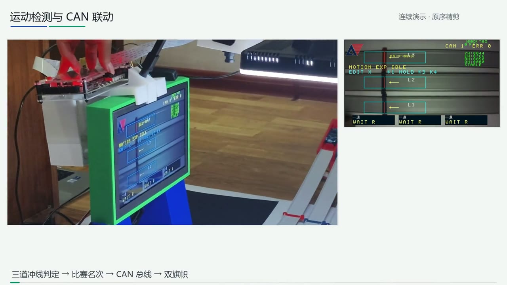

# 基于FPGA的实时视觉感知系统

整理日期：2026-11-04。目标器件 PH1P35MDG324 / Speed -3，顶层 `design_top_wrapper`，安路 TD 6.2.168116；既有仿真使用 ModelSim 2020.4。工程包含完整 FILL、三色识别、三道运动检测与唯一排名、七槽 720p DDR 证据回放，以及 500 kbit/s 双轴 CAN 旗帜控制。

点击画面播放完整演示（2 分 55 秒，1080p）。

## 快速入口

1. 解压到短的 ASCII 路径（例如 `D:/QRS_FPGA_Code`）。TD、ModelSim 等工具需另行安装，不在包内。
2. 最新 bit 就在仓库根目录：`motion_can_hidden_20261104_5a5d32b2.bit`，SHA256 见同名 `.sha256` 与 `RELEASE.json`。`program/` 另存归档副本及可见探针版 `motion_can_probe_20261104_a820495a.bit`。
3. 源码工程：`project/td_project/camera_to_dsi_display.al`。RTL、IP、头文件与约束均位于 `project/`，109 个 AL 引用全部随包提供，生产源文件与发布时哈希一致；AL 与 run PRJ 已改为相对路径。
4. 上板操作见 `docs/START_AND_KEYS.md`；完整按键与图像/颜色/FILL 操作见 `docs/FULL_KEY_GUIDE_REFERENCE.md`；探针读数见 `docs/PROBE_FIELDS_REFERENCE.md`；第三方代码归属见 `docs/THIRD_PARTY.md`。

## 目录

| 目录 | 内容 |
| --- | --- |
| `demo.mp4` | 一镜到底演示视频（1080p，2:55），封面图 `demo_poster.jpg` |
| `project/` | TD 工程、RTL、IP、约束与各模块接口说明 |
| `program/` | 已构建 bit 及 SHA256 侧车文件 |
| `database/` | 用于布线后复现的 TD 数据库 |
| `scripts/` | 工程加载、位流重生成与显示变体复现 |
| `sim/` | ModelSim 测试平台与输入向量 |
| `verification/` | 时序、布线等价、显示比对与实板通信核对记录 |
| `docs/` | 上板与模块说明 |

## 哈希与记录

- 本工程采用 MIT 许可，见根目录 `LICENSE`；`project/user_source/hdl_source/can/` 等第三方代码保留其原始许可，见 `docs/THIRD_PARTY.md`。
- 生产 RTL、约束与 SDC 保持构建时字节，发布的 bit 与源码一致。
- `docs/` 与 `sim/inputs/` 下的说明性文件为公开发布做过措辞与路径整理；其中 5 个测试平台改为包内相对路径。
- `RELEASE.json` 与 `FILE_MANIFEST.json` 记录当前包内文件的哈希；`verification/` 保留各次运行当时的输入哈希。
